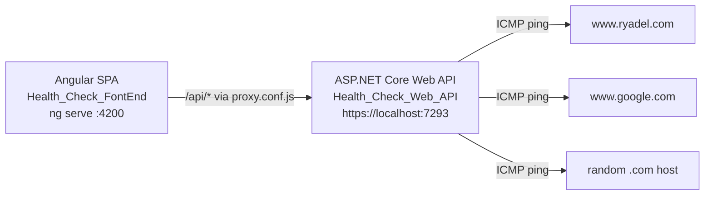

# HealthCheckApp

An ASP.NET Core Web API with custom ICMP (ping) health checks, plus an Angular single-page application that shows the results in a table.

## Features

- **ICMP health checks** built on ASP.NET Core Health Checks (`ICMPHealthCheck`):
  - `Healthy` when the ping succeeds within the round-trip threshold (100 ms)
  - `Degraded` when the ping succeeds but takes longer than the threshold
  - `Unhealthy` when the ping fails or throws
- Three checks are registered in `Program.cs`:

  | Name | Host | Purpose |
  | --- | --- | --- |
  | `ICMP_01` | `www.ryadel.com` | External host |
  | `ICMP_02` | `www.google.com` | External host |
  | `ICMP_03` | `www.<random-guid>.com` | Non-existent host, so it always reports `Unhealthy` |

- **Custom JSON response writer** (`CustomHealthCheckOption`) that returns each check's name, response time, status and description, plus the overall status and total duration
- **Angular SPA** with an Angular Material toolbar and three routes:
  - `/`: home page
  - `/fetch-data`: weather forecast sample from the API
  - `/health-check`: table of health check results from `/api/health`
- Swagger UI for the API in Development

## Tech stack

| Layer | Technology | Version |
| --- | --- | --- |
| Back end | .NET / ASP.NET Core (`net7.0`) | 7 |
| | Microsoft.AspNetCore.OpenApi | 7.0.5 |
| | Microsoft.EntityFrameworkCore | 7.0.5 (referenced, not used yet) |
| | Swashbuckle.AspNetCore | 6.4.0 |
| Front end | Angular (core, router, forms, animations) | 15.2.9 (`^15.2.0`) |
| | Angular Material / CDK | 15.2.9 |
| | Angular CLI | 15.2.8 |
| | TypeScript | 4.9.5 (`~4.9.4`) |
| | RxJS | 7.8.1 (`~7.8.0`) |
| Tests | Karma + Jasmine | 6.4 / 4.5 |

Versions in brackets are the ranges in `package.json`. The others are the versions locked in `package-lock.json`.

## Architecture



```
Health_Check.sln
├── Health_Check_Web_API/      ASP.NET Core Web API
│   ├── ICMPHealthCheck.cs     IHealthCheck implementation using System.Net.NetworkInformation.Ping
│   ├── CustomHealthCheckOptions.cs  JSON response writer
│   └── Controllers/           WeatherForecastController
└── Health_Check_FontEnd/      Angular 15 SPA
    └── src/app/               home, fetch-data, health-check, nav-menu
```

## API endpoints

| Method | Route | Description |
| --- | --- | --- |
| GET | `/api/health` | Runs all health checks and returns JSON (see below) |
| GET | `/api/WeatherForecast` | Template sample: 5 random weather forecasts |
| GET | `/swagger` | Swagger UI (Development only) |

Shape of the `/api/health` response (the values are only an example):

```json
{
  "checks": [
    { "name": "ICMP_01", "responseTime": 42.1, "status": "Healthy", "description": "ICMP to www.ryadel.com took 30 ms." }
  ],
  "totalStatus": 2,
  "totalResponseTime": 120.5
}
```

`totalStatus` is the numeric `HealthStatus` value: 0 = Unhealthy, 1 = Degraded, 2 = Healthy. The endpoint always returns HTTP 200, even when a check is unhealthy.

## Prerequisites

- A .NET SDK that can target `net7.0`. The project builds with the .NET 7 SDK or newer. Newer SDKs show warning `NETSDK1138` because .NET 7 is out of support.
- To run the API, an ASP.NET Core 7 runtime, or roll-forward to a newer one (see below).
- Node.js and npm. Angular CLI 15 officially supports Node 14.20+, 16.13+ and 18.10+. `npm ci` and `ng build` also work on Node 22.
- A trusted ASP.NET Core HTTPS development certificate: `dotnet dev-certs https --trust`
- Outbound ICMP access for the ping checks

## Configuration

- `Health_Check_Web_API/appsettings.json` only holds logging settings and `AllowedHosts`. The health check hosts and the 100 ms threshold are set in `Program.cs`.
- API launch profiles (`Properties/launchSettings.json`): `https` on `https://localhost:7293` and `http://localhost:5169`.
- Front-end proxy (`Health_Check_FontEnd/src/proxy.conf.js`): `/api` goes to `https://localhost:7293`.
- `src/environment/environment..ts` sets `baseUrl: "/"`, which the components use.

## Running locally

### Back end

```bash
cd Health_Check_Web_API
dotnet restore
dotnet run --launch-profile https
```

Swagger UI: `https://localhost:7293/swagger`. Health endpoint: `https://localhost:7293/api/health`. If only a newer ASP.NET Core runtime is installed, set `DOTNET_ROLL_FORWARD=Major` first.

### Front end

```bash
cd Health_Check_FontEnd
npm install
npm start
```

`npm start` first runs `aspnetcore-https.js`, which exports the ASP.NET Core development certificate. It then starts `ng serve` over HTTPS with that certificate, on `https://localhost:4200` by default. The `start` script uses Windows `%APPDATA%` paths. On macOS or Linux, run `npx ng serve` instead, or change the certificate paths.

You can also open `Health_Check.sln` in Visual Studio 2022 and start both projects together.

### Production build

```bash
cd Health_Check_FontEnd
npm run build   # output: dist/angularapp
```

## Tests

```bash
# Front-end unit tests (Karma + Jasmine, needs Chrome)
cd Health_Check_FontEnd
npm test
# single run in CI-style mode:
npx ng test --watch=false --browsers=ChromeHeadless
```

Three of the four generated specs currently fail. The `AppComponent` spec does not declare the nav-menu component, and it still expects the original template. The back end has no test project yet.
